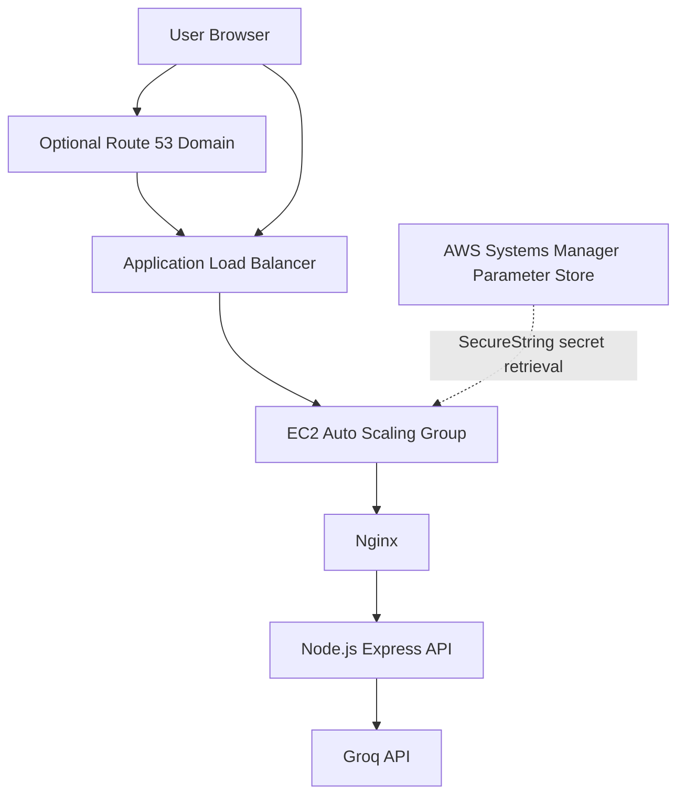

# Converra – AI Chat Application on AWS

Converra is a web-based AI chat application powered by the Groq API. It provides a ChatGPT-style interface, model selection, conversation history in the browser, and a Node.js backend.

## Project Overview

| Component | Technology |
|---|---|
| Frontend | HTML, CSS, JavaScript |
| Web server / reverse proxy | Nginx |
| Backend | Node.js, Express |
| AI inference | Groq API |
| Containerization | Docker, Docker Compose |
| Cloud | AWS |
| Region | ap-south-1 (Mumbai) |
| Compute | EC2 Auto Scaling Group |
| Load balancing | Application Load Balancer |
| Secrets | AWS Systems Manager Parameter Store |
| Network | VPC, public/private subnets, IGW, NAT Gateway |

## Features

- Chat interface with responsive layout.
- Groq-powered AI responses.
- Model selection.
- Conversation history saved in browser localStorage.
- Copy response and code functionality.
- Backend health endpoint.
- Nginx reverse proxy for API requests.
- Docker-based local deployment.
- AWS deployment behind an Application Load Balancer.
- EC2 instances managed through Auto Scaling.
- Groq API key retrieved from AWS Systems Manager Parameter Store.

## Architecture



The application instances run in private subnets. The ALB is internet-facing and distributes requests to healthy EC2 targets. Nginx serves the frontend and proxies API calls to the Node.js service.

## AWS Network

Region: `ap-south-1`

VPC: `converra-vpc`

The VPC contains six subnets across two Availability Zones:

| Availability Zone | Subnet | Purpose |
|---|---|---|
| ap-south-1a | converra-subnet-public1-ap-south-1a | Public resources |
| ap-south-1a | converra-db-a | Reserved DB subnet |
| ap-south-1a | converra-subnet-private1-ap-south-1a | Private application resources |
| ap-south-1b | converra-subnet-public2-ap-south-1b | Public resources |
| ap-south-1b | converra-db-b | Reserved DB subnet |
| ap-south-1b | converra-subnet-private2-ap-south-1b | Private application resources |

Network components:

- `converra-igw` – Internet Gateway.
- `converra-nat` – NAT Gateway.
- `converra-rtb-public` – public route table.
- `converra-rtb-private` – private route table.
- `rtb-09db67be9b7509abe` – additional route table; association should be verified in AWS.

The DB subnets are reserved network resources. **This project does not currently deploy or require RDS.**

See [Networking documentation](docs/NETWORKING.md).

## Run Locally with Docker

### Prerequisites

- Windows, Linux, or macOS
- Docker Desktop or Docker Engine
- Docker Compose
- Groq API key

### Setup

```powershell
git clone https://github.com/Geetha-1997/converra.git
cd converra

Copy-Item .env.example .env
notepad .env
```

Set the following values in `.env`:

```dotenv
GROQ_API_KEY=your_groq_api_key
GROQ_MODEL=openai/gpt-oss-20b
```

Do not commit `.env` or share your API key.

Start the application:

```powershell
docker compose up --build -d
```

Open:

`http://localhost:8082`

Check containers:

```powershell
docker compose ps
docker compose logs -f
```

Stop:

```powershell
docker compose down
```

The Compose frontend port is `8082`. The application does not use PostgreSQL for conversation storage.

## Backend API

| Method | Endpoint | Purpose |
|---|---|---|
| GET | `/health` | Health check |
| GET | `/api/models` | Available model list |
| POST | `/api/chat` | Send chat messages to Groq |

Example health check:

```powershell
Invoke-RestMethod http://localhost:8082/health
```

Example models request:

```powershell
Invoke-RestMethod http://localhost:8082/api/models
```

The chat endpoint expects a JSON body containing a non-empty `messages` array. The browser sends the recent conversation with each request.

## AWS Deployment

The deployed AWS environment uses:

- VPC `converra-vpc`.
- Public and private subnets in two Availability Zones.
- Internet Gateway and NAT Gateway.
- Internet-facing Application Load Balancer.
- HTTPS listener and HTTP-to-HTTPS redirect.
- Target group health check path `/health`.
- EC2 Auto Scaling Group.
- Nginx frontend and reverse proxy.
- Node.js backend on port `3000`.
- SSM Parameter Store SecureString for the Groq key.

ALB DNS:

`converra-alb-1263767965.ap-south-1.elb.amazonaws.com`

Use a domain name covered by the ACM certificate for trusted HTTPS access. The AWS-generated ALB hostname should not be assumed to match a certificate issued for a custom domain.

See [Deployment](docs/DEPLOYMENT.md), [Security](docs/SECURITY.md), and [Operations](docs/OPERATIONS.md).

## Repository Structure

```text
converra/
├── backend/
│   ├── Dockerfile
│   ├── package.json
│   └── server.js
├── frontend/
│   ├── Dockerfile
│   ├── index.html
│   └── nginx.conf
├── deploy/
│   └── user-data.sh
├── docs/
│   ├── ARCHITECTURE.md
│   ├── NETWORKING.md
│   ├── DEPLOYMENT.md
│   ├── SECURITY.md
│   ├── OPERATIONS.md
│   ├── CI-CD.md
│   ├── COST.md
│   └── TROUBLESHOOTING.md
├── .env.example
├── .gitignore
├── docker-compose.yml
└── README.md
```

## CI/CD Status

The repository currently contains application and deployment files, but no GitHub Actions workflow was present during this documentation review. CI/CD automation is documented as a future implementation, not as an existing deployment pipeline.

See [CI/CD](docs/CI-CD.md).

## Monitoring

Current operational checks include:

- ALB target group health.
- EC2 Auto Scaling Group instance health.
- SSM managed-instance connectivity.
- Backend `/health` endpoint.
- systemd service status and application logs.

CloudWatch alarms and dashboards should be verified separately before being described as deployed.

## Security

- Keep API credentials out of source control.
- Use SSM Parameter Store SecureString for the Groq API key.
- Give EC2 only the IAM permissions it needs.
- Keep application EC2 instances in private subnets.
- Allow application traffic from the ALB security group.
- Restrict administrative access.
- Use HTTPS with a valid ACM certificate matching the requested domain.

## Documentation

- [Architecture](docs/ARCHITECTURE.md)
- [Networking](docs/NETWORKING.md)
- [Deployment](docs/DEPLOYMENT.md)
- [Security](docs/SECURITY.md)
- [Operations](docs/OPERATIONS.md)
- [CI/CD](docs/CI-CD.md)
- [Cost](docs/COST.md)
- [Troubleshooting](docs/TROUBLESHOOTING.md)

## Current Limitations and Follow-up Work

1. Verify and update the EC2 launch-template user-data script: the checked-in script references the old `/groqchat/GROQ_API_KEY` parameter path, while the working deployment uses the `groq-chat` parameter.
2. Verify ACM certificate domain coverage and test HTTPS with certificate validation enabled.
3. Verify actual route-table-to-subnet associations.
4. Add automated CI/CD workflows.
5. Verify CloudWatch alarms, dashboards, and log retention.
6. Consider adding authentication, rate limiting, and persistent server-side conversation storage if required.

## License

Add a license before redistributing this project.
