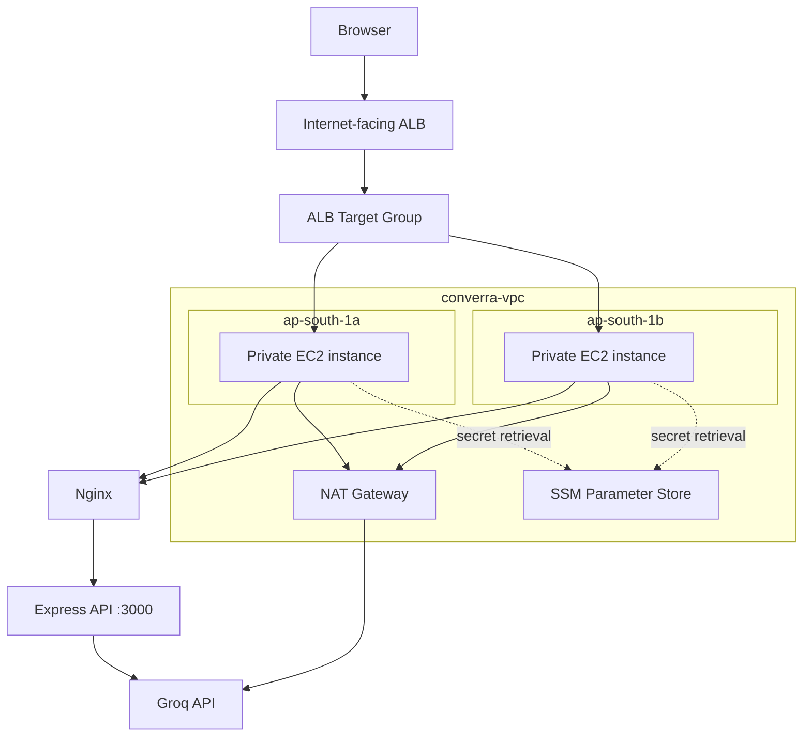

# Converra Architecture

## Overview

Converra is a browser-based AI chat application. The frontend is served by Nginx. Nginx forwards API requests to a Node.js Express backend. The backend calls the Groq API.

## Request Flow

1. A user opens the application through the Application Load Balancer.
2. The ALB forwards traffic to a healthy EC2 target.
3. Nginx serves `frontend/index.html`.
4. Requests to `/api/` and `/health` are proxied to `127.0.0.1:3000`.
5. Express handles the request.
6. For chat requests, Express sends the messages and selected model to the Groq API.
7. The response is returned to the browser.

## AWS Architecture Diagram

The diagram represents the documented logical design. Confirm live subnet associations and resource configuration before using it as an exact AWS topology export.

## Application Components

### Frontend

- Static HTML, CSS, and JavaScript.
- Responsive chat interface.
- Model selector.
- Recent conversations saved in browser localStorage.
- Sends recent messages to `/api/chat`.

### Backend

- Node.js and Express.
- Listens on port `3000` by default.
- Reads `GROQ_API_KEY` and `GROQ_MODEL` from environment variables.
- Provides `/health`, `/api/models`, and `/api/chat`.

### Nginx

- Serves frontend static files.
- Proxies `/api/` to the backend.
- Proxies `/health` to the backend.

### Groq

The backend calls:

`https://api.groq.com/openai/v1/chat/completions`

The configured default model is `openai/gpt-oss-20b`. Model availability and provider limits can change.

## AWS Components

| Component | Responsibility |
|---|---|
| VPC | Network isolation |
| Public subnets | ALB and public network components |
| Private subnets | Application instances |
| Internet Gateway | Internet connectivity for public resources |
| NAT Gateway | Outbound internet access from private resources |
| ALB | Distributes incoming requests |
| Target group | Tracks application target health |
| Auto Scaling Group | Maintains EC2 capacity |
| SSM Parameter Store | Stores the Groq key as SecureString |
| IAM instance role | Grants EC2 permission to retrieve the parameter |

## Data and Persistence

The backend is stateless. The browser stores conversation history in localStorage. This is browser-specific storage, not a central database or shared conversation store.

No RDS database is currently required or deployed as part of the documented application.
