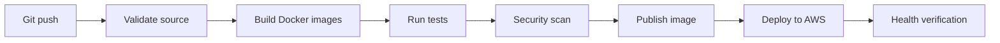

# Converra CI/CD

## Current State

The repository review found no `.github/workflows` directory or GitHub Actions workflow file.

Therefore, automated CI/CD is not currently documented as implemented. The application is stored in GitHub and the AWS instances retrieve application code through the deployment bootstrap process.

## Recommended Pipeline

A future GitHub Actions pipeline can use these stages:

## Recommended Controls

- Trigger on pull requests and approved pushes to `main`.
- Run source validation and tests before deployment.
- Build versioned container images.
- Scan dependencies and images.
- Store deployment credentials in GitHub Actions secrets or use AWS OIDC.
- Prefer short-lived AWS credentials through OIDC.
- Require deployment approval for production.
- Verify the ALB target group after deployment.
- Keep a rollback path to the previous application version.

## AWS Authentication

Prefer GitHub Actions OpenID Connect (OIDC) over long-lived AWS access keys.

Create a dedicated IAM role with only the permissions required for the deployment workflow.

Do not place AWS access keys or the Groq API key in workflow source files.

## Deployment Strategy

A future deployment workflow should:

1. Check out the repository.
2. Install dependencies.
3. Run tests and validation.
4. Build the application artifact or container image.
5. Publish a versioned artifact.
6. Deploy using a controlled AWS deployment method.
7. Verify `/health`.
8. Report deployment status.

## Current Limitation

This document describes a proposed pipeline. It does not claim that GitHub Actions, automated image publishing, or automated AWS deployment currently exists.
