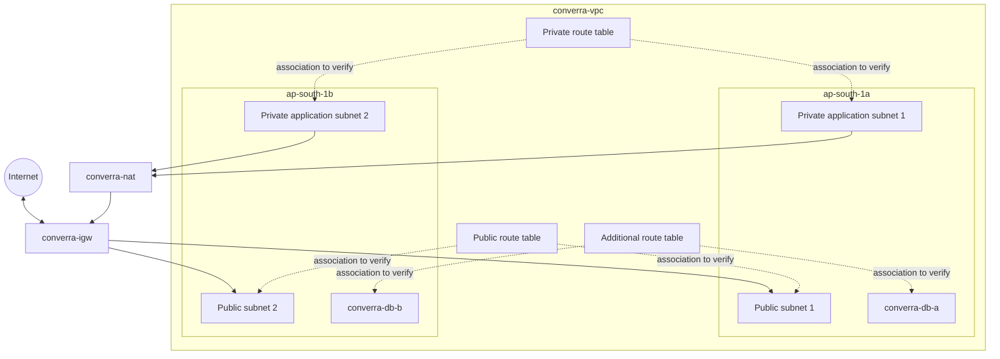

# Converra AWS Networking

## VPC

- Name: `converra-vpc`
- Region: `ap-south-1`
- Availability Zones: `ap-south-1a` and `ap-south-1b`
- Subnet count: 6
- Route table count: 3
- Internet Gateway: `converra-igw`
- NAT Gateway: `converra-nat`

## Subnets

| Availability Zone | Subnet name | Intended purpose |
|---|---|---|
| ap-south-1a | converra-subnet-public1-ap-south-1a | Public tier |
| ap-south-1a | converra-db-a | Reserved database tier |
| ap-south-1a | converra-subnet-private1-ap-south-1a | Private application tier |
| ap-south-1b | converra-subnet-public2-ap-south-1b | Public tier |
| ap-south-1b | converra-db-b | Reserved database tier |
| ap-south-1b | converra-subnet-private2-ap-south-1b | Private application tier |

The database subnet names do not mean that an RDS database currently exists. Converra currently uses browser localStorage for chat history.

## Network Components

| Resource | Name |
|---|---|
| VPC | converra-vpc |
| Internet Gateway | converra-igw |
| NAT Gateway | converra-nat |
| Public route table | converra-rtb-public |
| Private route table | converra-rtb-private |
| Additional route table ID | rtb-09db67be9b7509abe |

## Logical Network Flow

The route-table association lines are illustrative, not confirmed associations. Verify the actual AWS route table association records before relying on this diagram for troubleshooting.

## Routing Concepts

### Public route table

A public subnet normally has a default route to the Internet Gateway. Resources also need appropriate public IP addressing and security-group rules to communicate directly with the internet.

### Private route table

Private application subnets normally use a default route to a NAT Gateway for outbound internet access. The application instances do not need public IP addresses for this outbound path.

### Database route table

The DB subnets are reserved. No RDS deployment is included in the current application.

## Security Recommendations

- Do not expose backend port 3000 directly to the internet.
- Allow inbound application traffic from the ALB security group.
- Restrict SSH access to trusted sources if SSH is required.
- Prefer Systems Manager Session Manager for administrative access.
- Keep private application instances without public IP addresses.
- Review route tables and network ACLs before changing connectivity.

## Verification

Use the AWS Console or AWS CLI to verify:

- VPC ID and CIDR.
- Subnet IDs, CIDRs, and AZs.
- Route table associations.
- Default routes.
- NAT Gateway state and subnet.
- Internet Gateway attachment.
- Security group rules.

Do not infer subnet CIDRs or associations from resource names alone.
